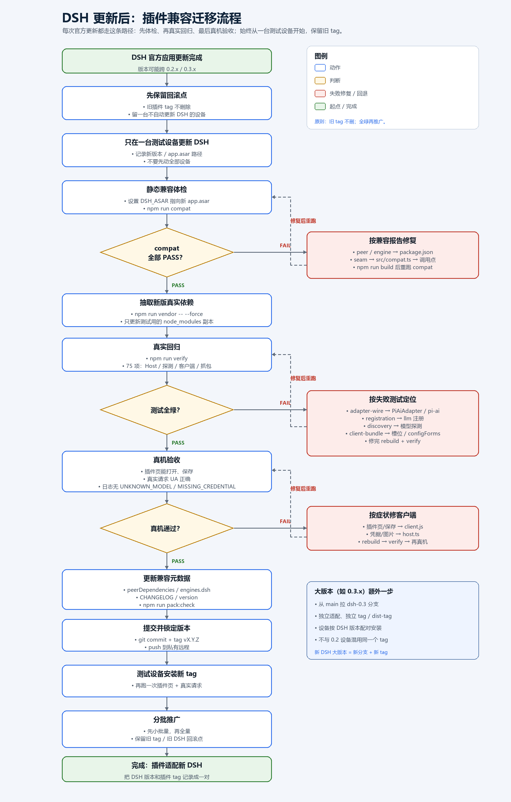

# DSH 升级兼容与迁移策略

目标不是“假设官方永远不变”，而是把一次大版本迁移压缩成**可定位、可验证、可回滚**的几步：

1. 所有 DSH / pi-ai 依赖收敛到 **一个文件**；
2. 升级后先做**静态兼容体检**，再跑**真实适配器测试**；
3. 客户端槽位/服务失败时给出明确诊断，而不是白屏；
4. 每个 DSH 大版本对应一个插件 tag / 分支，设备按版本组合安装。



> 只有一台 Windows 主机？按 [SINGLE-HOST.md](SINGLE-HOST.md) 操作：本地 `link:` + fallback 路由，不需要第二台设备。

---

最新实测记录见 [0.2.2-rc.1 验证报告](RC1-022-VALIDATION.md)（2026-11-06）。

## 1. 当前兼容基线

| 包 | 已验证版本 |
|---|---|
| DSH | `0.2.2-rc.1` |
| Cordis | `4.1.0` |
| `@deepseek-ai/dsh-llm` | `0.2.2-rc.1` |
| `@deepseek-ai/dsh-llm-pi-ai` | `0.2.2-rc.1` |
| `@earendil-works/pi-ai` | `1.3.0` |
| schemastery | `3.19.0` |

```powershell
npm run compat
```

它读取安装目录的 `app.asar`，输出 peer/engines 与内部接缝的 PASS/WARN/FAIL。当前应全部 PASS。

本插件自身版本为 `v0.1.0`，与上表的 DSH / 依赖版本独立递增；插件版本写在
`package.json` 的 `version`，安装目录为指向本仓库的 `link:`。

---

## 2. 四层兼容设计

### 2.1 单一边界：`src/compat.ts`

其余源码**只从 `src/compat.ts` 导入** DSH / pi-ai 符号。官方如果改了包名、导出名或模块路径，
先改这一个文件，再让 TypeScript 指到剩余调用点。

`checkCompat()` 在 `apply()` 开始时检查关键符号仍是可调用函数；致命问题会打明确日志并
停止注册，避免路由静默坏掉。

### 2.2 静态体检：`tools/compat-check.mjs`

只读 `app.asar`，检查：

- `peerDependencies` 与 installation 实际版本；
- `engines.dsh`；
- `PiAiAdapter` 是否仍使用 `profile.piProvider`；
- 官方 `requestHeaders()` 是否仍过滤 attribution 冲突；
- 三种 pi-ai 协议是否仍把 `options.headers` 最后合并；
- `registerAdapter` / `registerModelDiscovery` / `attributionHeaders` 是否存在；
- 客户端是否仍有 `settings.section` 与 `configForms`。

```powershell
npm run compat
# 或指定另一台设备的安装
node tools/compat-check.mjs --asar "D:\DSH\resources\app.asar"
```

发布包也带这个工具，可在目标设备直接运行：

```powershell
node node_modules/dsh-plugin-custom-headers/tools/compat-check.mjs --asar "C:\Path\To\app.asar"
```

这是升级后的第一道门，比启动聊天再观察错误更快。

### 2.3 真实回归：`npm run verify`

`test/adapter-wire.test.mjs` 使用真实 `PiAiAdapter`、真实 pi-ai 协议实现和真实 SDK，
只把 baseURL 指向本地记录服务。它验证的是“配置的 UA 真的到线上”，而不是配置对象里有没有值。

```powershell
$env:DSH_ASAR = 'C:\Tools\DeepSeek Harness\resources\app.asar'
npm run vendor -- --force
npm run verify
```

### 2.4 客户端契约守卫

`client.js` 的 `apply()` 检查 `slots` / `locale` / `configForms` 的核心方法。真正缺失时
隐藏页面并输出精确的缺失列表；`configForms.describe` 和 `remote.llm.discoverModels`
只影响诊断/拉取模型，缺失时降级而不是整页消失。

客户端测试只固定“我们这一侧”的契约；官方 UI 包改名仍需人工打开设置页确认。

---

## 3. 新 DSH 版本的迁移 Runbook

### 第 0 步：保留回滚点

```powershell
git tag
git status
```

至少保留一台**不自动更新 DSH** 的设备。

### 第 1 步：只在一台测试设备更新 DSH

记录 About 页或 `app.asar` 里的新版本。

### 第 2 步：静态体检

```powershell
$env:DSH_ASAR = 'C:\Path\To\New\app.asar'
npm run compat
```

- `FAIL peer/engine`：先更新 `package.json` 的 `peerDependencies` / `engines.dsh`；
- `FAIL seam`：按下一节定位；
- 全部 PASS 也继续第 3 步。

### 第 3 步：用新版依赖跑回归

```powershell
npm run vendor -- --force
npm run verify
```

`vendor` 从新版 `app.asar` 抽取真实副本；`verify` 跑 87 项测试，包括抓包断言。

### 第 4 步：按症状改代码

| 症状 / 体检失败 | 第一处修改 | 说明 |
|---|---|---|
| 导入失败、导出名变化 | `src/compat.ts` | 只改导入/再导出 |
| `UNKNOWN_MODEL` / `NO_ADAPTER` | `src/adapter.ts`、`src/models.ts` | `profile.piProvider` 接缝没了，需要换适配器或 provider 注入方式 |
| UA 变回 `deepseek-harness/...` | `src/models.ts` | pi-ai 不再最后合并 `options.headers`，需要换注入点 |
| 配置 schema 报错 | `src/config.ts` | schemastery / `RetryPolicySchema` 变化 |
| 凭据、图片、replay 报错 | `src/host.ts` | credentials/attachments 接缝变化 |
| 模型探测失效 | `src/discovery.ts` | listing 协议或 `attributionHeaders` 变化 |
| 设置页消失 | `client.js` | 槽位 `settings.section` 或 `configForms` 改名 |
| 保存失败 | `client.js` 的 `mutate`/draft 逻辑 | 设置写入语义变化 |

先改 `compat.ts`，再改调用点，避免在多个文件里重复适配。

### 第 5 步：更新元数据

```json
"engines": { "dsh": ">=0.3.0 <0.4.0", "node": ">=22" }
```

同步更新 `peerDependencies`、`CHANGELOG.md`、版本号，然后：

```powershell
npm run verify
npm run pack:check
git add .
git commit -m "feat: support DSH 0.3"
git tag v0.1.1-dsh0.3
git push --tags
```

### 第 6 步：真机验收

1. 设置页能打开、保存；
2. 真实请求的 `User-Agent` 是配置值；
3. 日志无 `UNKNOWN_MODEL` / `NO_ADAPTER` / `MISSING_CREDENTIAL`；
4. 模型探测（如使用）正常。

### 第 7 步：分批推广

先 1 台 → 小批量 → 全量。回滚 = 安装旧 tag，并把 DSH 回退到对应版本。

---

## 4. 多版本并行维护策略

DSH 大版本变化时，不必让一个包同时兼容所有版本。推荐：

| 分支 / tag | DSH 范围 | 用途 |
|---|---|---|
| `main` | 最新已验证版本 | 日常开发 |
| `dsh-0.2` | `>=0.2.1-rc.2 <0.3.0` | 老设备维护 |
| `dsh-0.3` | `>=0.3.0 <0.4.0` | 新版本适配 |

私有 npm registry 可以用 dist-tag 区分：

```powershell
npm publish --tag dsh-0.2
npm publish --tag dsh-0.3
```

安装时按设备 DSH 版本选择：

```text
plugin_manager(action: "install_bundle", target: "dsh-plugin-custom-headers@dsh-0.2")
```

Git 分发则按 tag 安装：

```text
plugin_manager(
  action: "install_bundle",
  target: "git+ssh://git@github.com/<you>/dsh-plugin-custom-headers.git#v0.1.0"
)
```

原则：**DSH 版本和插件 tag 成对出现**，设备清单记录两者组合。

---

## 5. 仍然需要人工处理的情况

以下变化不是加一层薄封装就能自动消化的：

- `PiAiAdapter` 彻底移除 `profile.piProvider`，且不提供等价的 provider 注入点；
- pi-ai 改成在更底层裁剪/覆盖 `User-Agent`，provider 边界不再能覆盖；
- DSH 重新设计 LLM 适配器接口（例如不再用 `registerAdapter`）；
- 客户端设置页/设置服务整体重构；
- 官方开始提供受支持的 `headers.User-Agent` 配置。

遇到前三种，先在测试分支做完整迁移，再把插件版本号提升一个 major；遇到最后一种，
优先改用官方能力并逐步退役本插件。

---

## 6. 发布检查清单

- [ ] `npm run compat` 全部 PASS（或 WARN 已解释）
- [ ] `DSH_ASAR=<新安装> npm run vendor -- --force`
- [ ] `npm run verify` 87/87
- [ ] 更新 `peerDependencies` / `engines.dsh` / `CHANGELOG.md` / 版本号
- [ ] `npm run pack:check` 文件清单正确
- [ ] 测试设备安装并完成真机验收
- [ ] 打 tag、推送、分批升级

`npm run compat` 是**静态检查**，不能替代第 3 步的真实回归；`npm run verify` 也不能替代
设置页的人工检查。两者叠加，才能把一次大版本迁移控制在可预期范围内。
